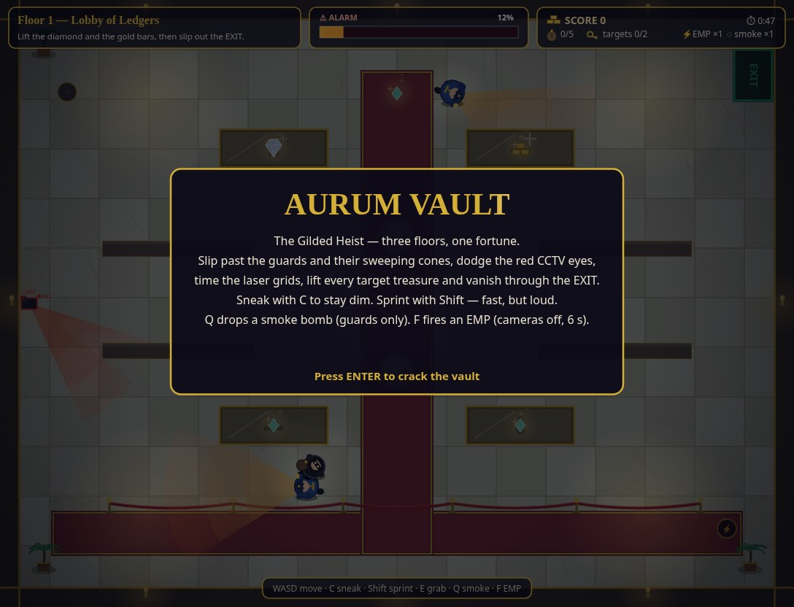
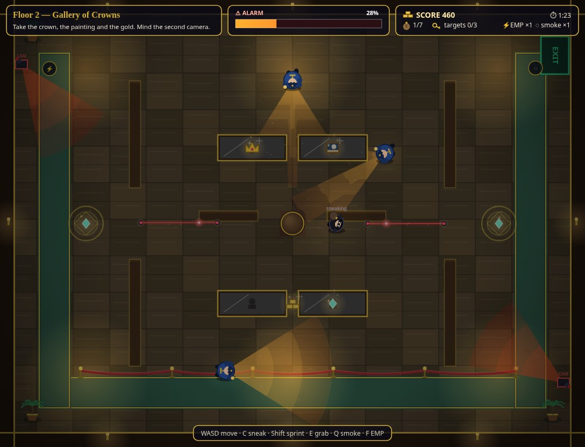
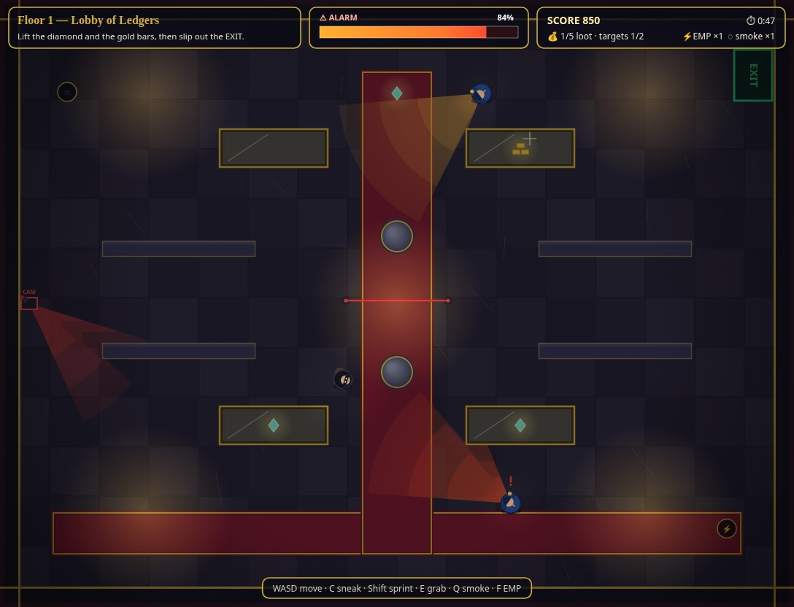
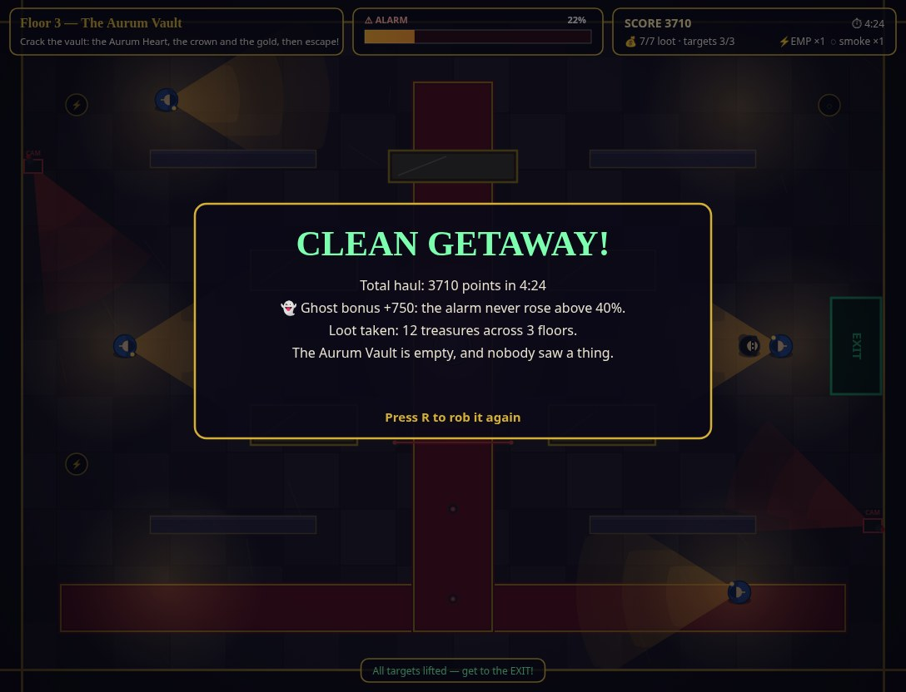

# AURUM VAULT — The Gilded Heist

**One thief, three gilded floors, and a fortune behind glass — lift every target treasure and vanish before the ALARM hits 100%.**

## At a glance

| | Floor 1 — Lobby of Ledgers | Floor 2 — Gallery of Crowns | Floor 3 — The Aurum Vault |
|---|---|---|---|
| Target loot | Diamond, gold bars | Crown, painting, gold bars | Aurum Heart, crown, gold bars |
| Guards | 2 | 3 | 4 |
| CCTV cameras | 1 | 2 | 2 |
| Laser grids | 1 | 2 | 3 |
| Optional gems | 3 | 4 | 4 |
| Tool pickups | Smoke bomb, EMP | EMP, smoke bomb | 2× EMP, smoke bomb |

**Tools:** Q — smoke bomb (invisible to guards for 3 s, cameras still see you) · F — EMP (every camera dark for 6 s) · C — sneak (slower, much dimmer in cones) · Shift — sprint (fast, and loud).

## Screenshots

| | |
|---|---|
|  |  |
| *Mid-heist: sneak past cones, camera and lasers, and keep the ALARM down.* | *Spotted! The cone turns red, the meter races — break line of sight.* |
|  |  |
| *Clean getaway — haul tallied, ghost bonus for a quiet run.* | *The title screen, staged over the live lobby.* |

## How to play

Open `game/index.html` in a desktop browser (or run `node serve.ts` and visit http://localhost:8080). No build step, no network — everything runs from the files in `game/`.

- **WASD / arrow keys** — move
- **C** (or Ctrl) — crouch-sneak: slow, but you fill the alarm far more slowly inside a cone
- **Shift** — sprint: fast, but running is loud and you show up bright in every cone
- **E** — grab loot / take a tool pickup when you are next to it
- **Q** — smoke bomb (limited charges): guards cannot see you for 3 seconds; cameras can
- **F** — EMP (limited charges): all cameras on the floor go dark for 6 seconds
- **Enter** — start · **R** — retry after a catch or a getaway

Each floor: grab its target treasures (diamonds, gold bars, crowns, paintings — gems are optional score), then reach the glowing **EXIT**. Guards patrol waypoints behind raycast vision cones that walls, pillars and display cases block; CCTV cameras sweep red cones that fill the alarm fast; laser grids blink on a timer and trip a spike of alarm. Fill the ALARM to 100% and the vault slams shut. Finish Floor 3 for the final tally — keep the alarm peak at or under 40% across the whole run for the **ghost bonus**.

## Design notes

- **One clear job per file** under `game/src/`: `config.js` holds every tuning number and all three floor layouts; `world.js` owns geometry — collision, line of sight, raycast cone polygons and the pre-rendered static floor layer; `guards.js` runs patrols and guard vision; `cameras.js` runs the CCTV sweeps, the EMP blackout and the laser grids; `input.js` and `audio.js` are the keyboard queue and the WebAudio synth (no audio files); `render.js` draws everything — sprites, feathered cones, lighting and the glass-and-gold HUD; `shots.js` stages the deterministic screenshot scenes; `main.js` is the loop and the run state.
- **Vision is real geometry.** Every cone is a fan of rays clipped by the same solid rects that block movement, so a display case that hides you from a guard also clips his cone on screen — what you see is exactly what can see you.
- **The static floor is pre-rendered once per floor** (marble tiles with gold veins, crimson carpet runners, glass cases, pillars, spotlight pools) to an offscreen canvas; the frame loop only paints actors, cones, lasers and a lighting overlay with a vignette.
- **Smoke and EMP are asymmetric on purpose:** smoke beats guards but not cameras, EMP beats cameras but not guards, so a charge is only ever half an escape — the other half is still your route.
- **Deterministic screenshots:** `?shot=start|play|alert|end` stages a frozen frame from the game's own state (fixed clock), so the four screenshots in `screenshots/` are real renders of the real game, reproducible from `shots.json`.
- **Animation pass:** the vault now moves — the thief and guards walk with real cycles (bobbing, swinging arms, swaying cloak, a loot sack that swells with the haul, a dash-stretch on sprint), CCTV cones sweep past blinking REC dots, laser beams pulse with a travelling bead of light and drifting dust, gold sparkles rise off every treasure and burst when it is grabbed, and a dim green wash settles over the shadows no eye is watching. Each floor wears its own palette (white-gold marble lobby, dark wood gallery, cold blue steel vault), the rooms are dressed with palms, rope barriers, sconces and floor medallions, and Floor 3 is built around a giant gold-plated vault door whose iron wheel turns as it swings open on the win screen — all of it render-only, so every patrol, cone and alarm number plays exactly as before.

---

Built with an AI coding agent for the make.fun "Make the best heist game" bounty.
